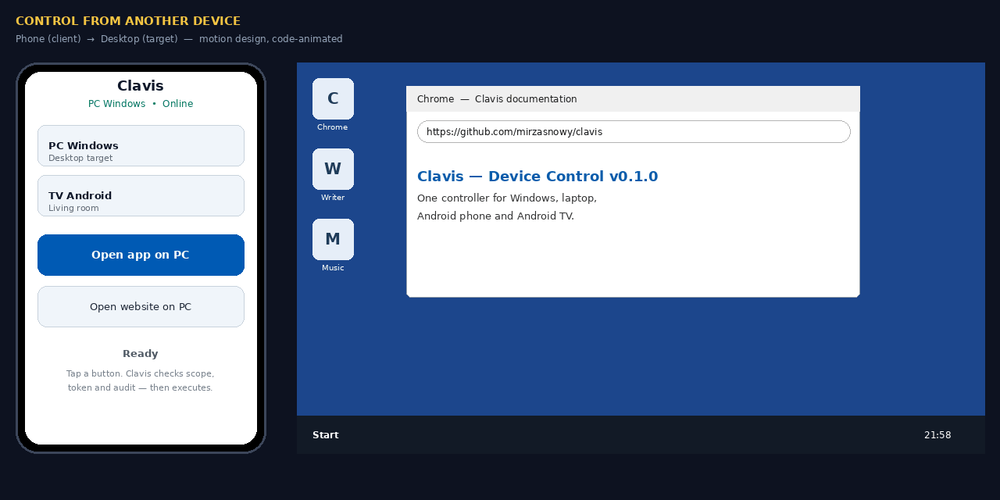
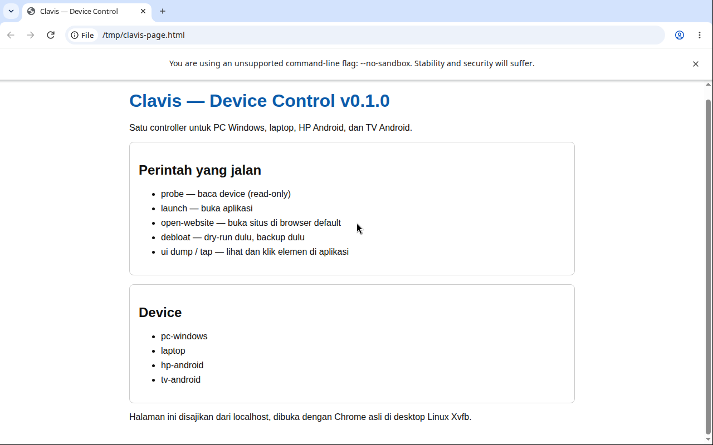

# Clavis

**One key for every device you own.**

Clavis controls a Windows PC, a laptop, an Android phone, and an Android TV from one controller. It debloats and customises the OS you already have, opens apps and websites, and inspects and clicks inside apps that are already open — under pairing, per-device scope, signed short-lived tokens, and a hash-chained audit log.

No OS replacement. No root. No cloud account. No public port.

[](LICENSE)


## Demo



*Motion design, animated in code: tap a button on the phone, Clavis checks scope, token and audit, then the app opens on the target desktop. The phone gateway shown here is a design concept, not yet built. The CLI and MCP tools below are what exists today.*



*Real screenshot, not AI illustration: Chrome on a bare Linux X session (Xvfb, no desktop environment, so no taskbar). This is not Windows and not Spotify — a Windows recording must come from a real Windows laptop.*

## Devices

| Device | Transport | Control |
| --- | --- | --- |
| PC Windows | PowerShell (local agent) | Apps, services, theme, debloat, UI Automation |
| Laptop (Windows/Linux) | PowerShell / SSH | Same, by detected OS |
| Android phone / TV | ADB | Apps, launcher, UI dump and tap, screenshot, app search by name |

iPhone is out of scope: it cannot be fully controlled from an agent.

## How it works

```
Harness (brain) → Clavis core → native driver → device
                     ↑ scope, token, audit, NEVER list
```

Clavis is a thin safety layer over native tools: PowerShell on Windows, apt/dnf/pacman and systemd on Linux, ADB on Android. It adds registry and scope, pairing, signed tokens, audit, NEVER lists, and backup/restore — the parts that make those tools safe to hand to an agent.

**Open, don't click.** Open an app only with `device_launch`, a site only with `device_open_website`. Clicks and taps are reserved for elements *inside* an app that is already open. A dedicated open is one deterministic OS intent with a clear audit entry; a click to open is screen-dependent and multi-step.

## Security

Full design: [`docs/security.md`](docs/security.md). In short:

- **Private mesh only** (WireGuard / Tailscale / Headscale). Agents listen only on the mesh IP.
- **Identity:** Ed25519 keypair per device, SHA-256 fingerprint. Private keys stay on the device at mode `0600`.
- **Pairing:** 6-digit SAS code compared on both screens; headless devices use a 5-minute one-time token bound to the fingerprint.
- **Tokens:** scope + 60-second expiry + nonce + command hash, signed with Ed25519.
- **Audit:** SHA-256 hash-chain, verifiable with `audit`.
- **NEVER lists:** Windows Store/.NET, Linux systemd/dbus, Android Settings/SystemUI are always blocked, even with `--confirm`.
- **MCP is dry-run only for destructive actions.** Real execution requires the CLI with `--confirm` on a paired device. This is deliberate: a prompt-injected host must not debloat a device through MCP alone.

The key proves a command comes from you. It is not an OS bypass: it cannot unlock disk encryption, enrol a biometric, or pass a CAPTCHA.

## Quick start

```bash
cd device-control
export PYTHONPATH=src
# Optional: pip install -e .            # then use `device-control` directly
# Optional: pip install -e ".[crypto]"  # Ed25519 via cryptography, otherwise openssl

python3 -m device_control.cli devices list
python3 -m device_control.cli probe --device laptop
python3 -m device_control.cli pair --device hp-android
```

Safe order on a real device: mesh → pair (compare SAS) → probe → backup → dry-run → confirm → audit. See `docs/quickstart-device.md` and `docs/OPERATIONS.md`.

## CLI and MCP

```bash
python3 -m device_control.cli apps --device laptop --dry-run
python3 -m device_control.cli debloat --device tv-android --list examples/debloat/generic-safe.txt --dry-run
python3 -m device_control.cli debloat --device tv-android --list examples/debloat/generic-safe.txt --confirm
python3 -m device_control.cli open-website --device pc-windows --url https://example.com --dry-run
python3 -m device_control.cli backup --device tv-android
python3 -m device_control.cli audit
python3 -m device_control.cli mcp   # MCP stdio server
PYTHONPATH=src python3 -m unittest discover -s tests -v
```

**14 MCP tools:** `device_list`, `device_probe`, `device_apps`, `device_services`, `device_debloat` (dry-run), `device_restore` (plan), `device_appearance` (dry-run), `device_backup`, `device_launch` (dry-run), `device_open_website` (dry-run), `device_ui`, `device_search_app`, `device_screenshot`, `audit_verify`.

## Harness setup

**Install (once):**

```bash
git clone https://github.com/mirzasnowy/clavis.git
cd clavis && pip install -e .   # or use PYTHONPATH=src from device-control/
```

Test the server first — it must list 14 tools:

```bash
cd device-control
PYTHONPATH=src python3 -m device_control.mcp_server <<'EOF'
{"jsonrpc":"2.0","id":1,"method":"tools/list"}
EOF
```

**Connect (same server, only the config file changes).** Replace `/path/to/clavis` with your real path. Drop the `PYTHONPATH` line if you installed with `pip install -e .`.

Claude Code (`.mcp.json`), Cursor / VS Code (Settings → MCP, or `.vscode/mcp.json`), Gemini CLI (`.gemini/settings.json`):

```json
{"mcpServers": {"device-control": {
  "command": "python3",
  "args": ["-m", "device_control.mcp_server"],
  "cwd": "/path/to/clavis",
  "env": {"PYTHONPATH": "src"}
}}}
```

Or, from a terminal:

```bash
claude mcp add device-control -- python3 -m device_control.mcp_server
```

Codex (`~/.codex/config.toml`):

```toml
[mcp_servers.device-control]
command = "python3"
args = ["-m", "device_control.mcp_server"]
cwd = "/path/to/clavis"
env = { PYTHONPATH = "src" }
```

OpenCode (`opencode.json`): same command and args, `"type": "local"`, `"directory": "/path/to/clavis"`, `"environment": {"PYTHONPATH": "src"}`, `"enabled": true`. Ready-made copies are in `configs/harness/`. Restart the harness after editing its config.

**Prompts to paste into the harness (safe: read-only or dry-run):**

```
List my Clavis devices with device_list, then probe tv-android
read-only with device_probe. Do not debloat anything yet.
```

```
Show me the dry-run debloat plan for tv-android from
examples/debloat/generic-safe.txt, and list what the NEVER
list blocks. Do not confirm anything.
```

```
Open https://example.com on pc-windows with
device_open_website (dry-run only), then show me the exact
CLI command to confirm it on the device.
```

MCP never executes a destructive action. When a dry-run plan looks right, run it in the CLI with `--confirm` on the device (see Quick start above). If the server fails with `ModuleNotFoundError: device_control`, your `cwd` or `PYTHONPATH` is wrong. Full version with troubleshooting: [`docs/harness-setup.md`](docs/harness-setup.md).

## Status

**Version 0.1.0 is intentionally 0.x.** It passes 42/42 tests on a Linux host — all dry-run paths, MCP JSON-RPC, Ed25519 via openssl, audit chain, NEVER filter, open-website generation, and a real read-only Linux probe (783 packages). It has **not** been tested on a real Windows host, Android device, or Linux desktop session, and the phone gateway is not built. Roadmap: real-device testing first, then the Tailscale-only phone web gateway.

## Layout

```
src/device_control/   cli, mcp_server, devices, security, pairing, backup, never,
                      adb, android, windows, linux, laptop, ssh, ui, appsearch,
                      winui, linuxui, openwebsite
scripts/              winui.ps1, linuxui.py
skills/device-control/SKILL.md
configs/harness/      Claude Code, Codex, OpenCode, Cursor, Gemini
examples/             debloat lists, appearance profiles
docs/                 INSTALL, OPERATIONS, security, device-matrix, quickstart-device,
                      harness-compatibility, ui-automation, capri-takeaways
tests/test_device_control.py
```

The Python package stays named `device_control` so imports do not break. **Clavis** (Latin for "key", pronounced "kla-vis") is the repository and brand name.

## License

MIT. See [LICENSE](LICENSE).
